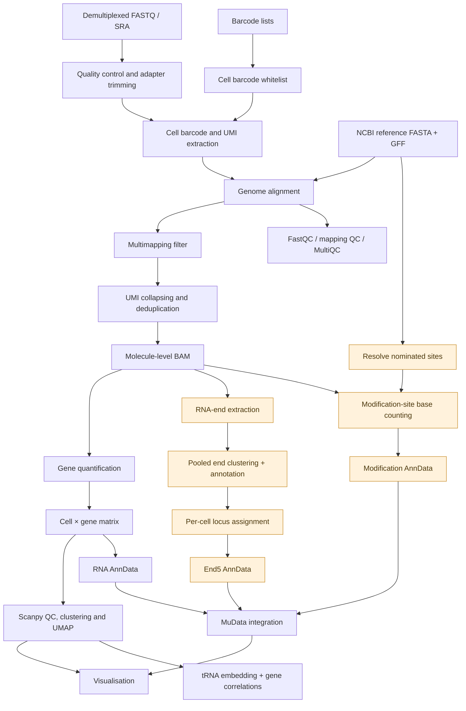

# sbRNA-seq

[](https://www.nextflow.io/)
[](https://www.docker.com/)
[](https://apptainer.org/)
[](https://github.com/scbirlab/nf-sbrnaseq/actions)

**sbRNA-seq** is a Nextflow DSL2 pipeline for processing bacterial single-cell RNA sequencing data from Illumina or Oxford Nanopore platforms.

Starting from demultiplexed FASTQ files, it identifies cell barcodes, collapses UMIs, quantifies gene expression, and performs single-cell analysis. Optional analyses measure genomic RNA-end usage and reverse-transcription substitutions at nominated RNA modification sites.

The pipeline produces count tables, AnnData (`.h5ad`), multimodal MuData (`.h5mu`), quality-control reports, and publication-ready visualisations.

## Contents

- [Quick start](#quick-start)
- [Workflow](#workflow)
- [Installation](#installation)
- [Inputs](#inputs)
  - [Sample sheet](#sample-sheet)
  - [Barcode files](#barcode-files)
- [Configuration](#configuration)
  - [Read processing](#read-processing)
  - [Gene expression](#gene-expression)
  - [RNA modification sites](#rna-modification-sites)
  - [RNA 5′ ends](#rna-5-ends)
  - [Functional annotation](#functional-annotation)
- [Outputs](#outputs)
  - [MuData structure](#mudata-structure)
  - [Visualisations](#visualisations)
- [Credits and support](#credits-and-support)

## Quick start

Suppose you have sequenced *E. coli* cells before and after antibiotic treatment. You want to identify transcriptionally distinct subpopulations, determine which genes distinguish them, and investigate whether RNA processing or modification-associated signatures vary between cells.

**1. Prepare your inputs.**

Organise your already demultiplexed reads, barcode lists, and sample sheet:

```
experiment/
├── samples.csv
├── inputs/
│   ├── bc1.csv
│   ├── bc2.csv
│   └── bc3.csv
└── fastqs/
    ├── control_R1.fastq.gz
    ├── control_R2.fastq.gz
    ├── treated_R1.fastq.gz
    └── treated_R2.fastq.gz
```

The [sample sheet](#sample-sheet) specifies each sample's reference genome, FASTQ matching pattern, barcode files, adapters, and UMI extraction patterns.

**2. Run the pipeline.**

With Nextflow and Singularity/Apptainer available:

```bash
nextflow run scbirlab/nf-sbrnaseq -r v0.1.0 \
    --sample_sheet samples.csv \
    --fastq_dir fastqs \
    --inputs inputs \
    --end5_enabled \
    -resume
```

This runs gene-expression analysis, RNA 5'-end analysis, and the default tRNA modification-site analysis.

Use `--mod_sites /path/to/sites.tsv` to supply a different site definition file. RNA-end analysis is optional; omit `--end5_enabled true` to disable it.

For local execution with Docker, add `-profile local -with-docker`. The standard profile is configured for SLURM and Singularity.

**3. Explore the results.**

Key outputs include:

```
results/
├── counts/             # Cell × gene UMI counts
├── scanpy/             # Filtered and clustered AnnData
├── mudata/             # Integrated multimodal data
│   └── control.h5mu
├── visualization/
│   ├── rna/            # Gene-expression UMAPs
│   ├── trna/           # tRNA embedding
│   ├── correlations/   # Gene coexpression
│   ├── modifications/  # RNA substitution patterns
│   └── end5/           # RNA-end usage
└── multiqc/            # Combined sequencing QC
```

For example, load a sample in Python:

```python
import mudata as mu

mdata = mu.read_h5mu("results/mudata/control.h5mu")

print(mdata.mod.keys())       # rna, end5, mod
rna = mdata["rna"]             # Cell × gene counts
ends = mdata["end5"]           # Cell × RNA-end locus counts
mods = mdata["mod"]            # Cell × modification-site observations
```

Only enabled modalities are present. See [MuData structure](#mudata-structure) for details.

For reproducibility, use `-r` to specify a piepeline version tag or git commit.

## Workflow



Orange nodes denote optional analysis branches.

### Processing stages

1. **Reference preparation:** Download NCBI assemblies and annotations; combine references when multiple assemblies are specified.
2. **Read processing:** Trim adapters, extract cell barcodes and UMIs, and align reads with STAR, Bowtie2 or minimap2.
3. **Molecule identification:** Filter alignments, collapse UMIs using UMICollapse, and construct deduplicated molecule-level BAMs.
4. **Gene quantification:** Count annotated features using featureCounts and generate cell × gene UMI matrices.
5. **Single-cell analysis:** Filter cells and genes, perform Scanpy clustering and UMAP, and calculate QC metrics.
6. **Additional molecular measurements:** Optionally identify genomic RNA-end loci and count bases at nominated modification sites.
7. **Integration and interpretation:** Assemble MuData, generate multimodal QC, visualise expression and locus usage, embed tRNA profiles, and calculate gene correlations.

FASTQ, alignment, cell-count and coverage metrics are consolidated into a MultiQC report.

## Installation

Requires:

- [Nextflow](https://www.nextflow.io/) (DSL2; compatible with the version constraint in `nextflow.config`)
- Singularity/Apptainer, Docker, or Conda
- Access to NCBI reference assemblies
- Sufficient memory and storage for alignment and single-cell analysis

The pipeline provides container and Conda environments for its dependencies.

Install Nextflow, for example:

```bash
conda install -c bioconda nextflow
```

On a cluster with environment modules:

```bash
module load Nextflow Singularity
```

Execution profiles:

| Profile | Execution |
| --- | --- |
| `standard` | SLURM with Singularity; configured for the Crick HPC |
| `local` | Local executor |
| `gh` | Local Docker execution for GitHub Actions |

Override process resources or execution settings in a separate Nextflow configuration file using `-c config-file`.

Run `nextflow run scbirlab/nf-sbrnaseq -r visualisation --help` for basic usage.

## Inputs

### Sample sheet

The CSV sample sheet contains one row per sample, with the reference genome, reads, barcode lists, adapter sequences and UMI extraction rules.

**Required fields for Illumina:**

| Column | Description |
| --- | --- |
| `sample_id` | Unique sample identifier |
| `genome_accession` | NCBI assembly accession (`GCF_...` or `GCA_...`) |
| `fastq_pattern` | Filename pattern within `fastq_dir` |
| `bc1`, `bc2`, `bc3` | Barcode-list filenames relative to `inputs` |
| `adapter_read1_5prime`, `adapter_read1_3prime` | R1 adapters |
| `adapter_read2_5prime`, `adapter_read2_3prime` | R2 adapters |
| `umi_read1`, `umi_read2` | UMI-tools regex patterns |

Adapter and UMI patterns are library-specific; they must describe the actual sequenced read structure.

Example:

```csv
sample_id,fastq_pattern,genome_accession,bc1,bc2,bc3,adapter_read1_5prime,adapter_read1_3prime,adapter_read2_5prime,adapter_read2_3prime,umi_read1,umi_read2
control,control_R,GCF_904425475.1,bc1.csv,bc2.csv,bc3.csv,TATAATAAN{8}N{7},CAGN{6}G{3},C{3}N{6}CTG,N{7}N{8}TTATTATA,^(?P<discard_1>.{3})(?P<cell_1>.{6}).*,^(?P<discard_2>.{8})(?P<cell_2>.{8})(?P<umi_1>.{7}).*
```

The example illustrates the sample-sheet format; substitute patterns appropriate to your experimental protocol.

Additional input modes:

- **Combined-reference experiments:** Join assembly accessions with `+` (e.g. *E. coli* + *B. subtilis*).
- **SRA:** Set `--from_sra true` and supply the `Run` accession. Account for prepended Illumina indices in extraction patterns.
- **Nanopore:** Set `--nanopore true` and provide `adapter_5prime`, `adapter_3prime`, and `umi` in place of the Illumina-specific columns.

### Barcode files

Each barcode CSV must contain a header and two columns; the second contains the barcode sequence.

```csv
Barcode ID,Sequence
barcode-01,ATCGATCC
barcode-02,TAGCTAGG
```

The whitelist is generated from the Cartesian product of the barcode rounds. Optional single-error variants support error-tolerant matching.

## Configuration

Parameters can be supplied through `--parameter value` or in a Nextflow configuration file.

### Read processing

| Parameter | Default | Description |
| --- | --- | --- |
| `sample_sheet` | `null` | Sample-sheet CSV |
| `fastq_dir` | `null` | Local FASTQ directory |
| `inputs` | `inputs` | Barcode and auxiliary input files |
| `outputs` | `outputs` | Output directory |
| `from_sra` | `false` | Retrieve reads from SRA |
| `nanopore` | `false` | Nanopore processing |
| `unpaired` | `false` | Unpaired-read handling |
| `trim_qual` | `5` | Cutadapt quality threshold |
| `min_length` | `9:38` | Minimum trimmed read lengths |
| `reverse` | `""` | Barcode rounds to reverse-complement |
| `allow_cell_errors` | `true` | Permit single-error barcode matching |
| `whitelist_chunk_size` | `500000000` | Maximum whitelist chunk size |
| `mapper` | `star` | `star`, `bowtie2` or `minimap2` |
| `min_mapq` | `3` | Minimum mapping quality |
| `disable_multimap` | `false` | Exclude multimapping reads when enabled |
| `max_multimaps` | `20` | Maximum alignments considered by supported mappers |
| `strand` | `1` | Library strandedness: `1` forward, `2` reverse |

Multimapping behaviour depends on the aligner and filtering configuration. Retaining multimapping reads does not imply that all reported alignments represent independent molecules.

### Gene expression

| Parameter | Default | Description |
| --- | --- | --- |
| `ann_type` | `gene` | GFF feature type(s) for counting |
| `label` | `locus_tag` | GFF attribute(s) used as gene IDs |
| `min_counts_per_cell` | `10` | Minimum UMI counts per cell |
| `min_cells_per_gene` | `2` | Minimum cells expressing a gene |

Gene quantification uses featureCounts, followed by Scanpy filtering, clustering and dimensionality reduction.

The pipeline also generates per-cell and per-gene count distributions, gene-body coverage and genome coverage profiles.

### RNA modification sites

The optional modification branch measures observed bases at nominated genomic sites, including sites associated with known tRNA modifications.

| Parameter | Default | Description |
| --- | --- | --- |
| `mod_sites` | `resources/trna-mod-sites.tsv` | Site definition TSV |
| `sites_join_on` | `feature` | Site-to-reference resolution rule |
| `mod_min_mapq` | `3` | Minimum alignment MAPQ |
| `mod_min_baseq` | `3` | Minimum base quality |

Sites are resolved against the reference FASTA and GFF before molecule-level counting.

For each cell and site, the pipeline records reference, alternative and other base counts, callable coverage, and mapping-confidence QC.

**Interpretation:** Observed substitutions are proxies for reverse-transcription behaviour, not direct measurements of RNA modification stoichiometry. Low coverage and ambiguous mapping can affect inference.

Set `mod_sites = null` in a configuration file to disable this branch.

### RNA 5′ ends

RNA-end analysis identifies reproducible genomic positions at which sequenced molecules terminate, without assuming that every position represents a transcription start site.

Enable with:

```bash
--end5_enabled true
```

| Parameter | Default | Description |
| --- | --- | --- |
| `end5_enabled` | `false` | Enable RNA-end analysis |
| `end5_read` | `1` | Selected read: `1` R1, `2` R2, `0` unpaired |
| `end5_boundary` | `5` | Selected read's 5′ or 3′ aligned boundary |
| `end5_include_softclip` | `false` | Include soft-clipped boundaries |
| `end5_min_support` | `3` | Minimum Paraclu cluster support |
| `end5_max_width` | `100` | Maximum retained locus width (nt) |

The workflow:

1. Extracts the selected boundary from deduplicated molecules, respecting library strandedness.
2. Pools ends across samples sharing a reference.
3. Identifies strand-specific clusters with [Paraclu](https://fantom.gsc.riken.jp/5/suppl/Paraclu/).
4. Retains non-overlapping loci and annotates their proximity to same-strand genes with BEDTools.
5. Assigns each molecule to at most one locus and produces cell × locus counts.

Loci may represent transcription initiation, RNA processing, or degradation. The selected sequenced-read boundary must correspond to the intended biological end for the library protocol.

### Functional annotation

Optional [eggNOG-mapper](https://github.com/eggnogdb/eggnog-mapper) annotations provide functional groupings for gene-correlation visualisations.

| Parameter | Default | Description |
| --- | --- | --- |
| `use_eggnog` | `false` | Download and use eggNOG functional annotations |
| `eggnogdb` | `false` | Local eggNOG database path, if available |
| `eggnog_url` | Configured URL | Remote database source |

Gene-correlation plots are generated without eggNOG annotations, but functional grouping requires annotation data.

## Outputs

All results are published beneath `params.outputs`.

| Directory | Contents |
| --- | --- |
| `molecules/` | Deduplicated, indexed molecule-level BAMs |
| `counts/` | Cell and gene UMI count tables |
| `featurecounts/` | FeatureCounts tables and summaries |
| `scanpy/` | AnnData, filtering, clustering and QC |
| `sites/` | Reference-resolved modification sites |
| `modifications/` | Per-cell nucleotide counts and site QC |
| `ends/` | Extracted ends, clustered loci, annotations, assignments and QC |
| `mudata/` | Multimodal `.h5mu` and modality-specific `.h5ad` |
| `mudata/qc/` | Multimodal QC figures and tables |
| `visualization/` | Single-cell analysis figures and supporting tables |
| `multiqc/` | Aggregated QC report |

Additional trimming, alignment and coverage outputs are published by their respective processes.

### MuData structure

Each sample has a MuData file containing the enabled modalities:

| Modality | Matrix | Measurement |
| --- | --- | --- |
| `rna` | Cell × gene | Gene UMI counts |
| `end5` | Cell × locus | Molecules assigned to genomic RNA-end loci |
| `mod` | Cell × site | Observed alternative-base counts at nominated sites |

Modification layers include:

- `ref_count`, `alt_count`, `other_count`
- `callable_depth`, `ref_alt_depth`
- `count_A`, `count_C`, `count_G`, `count_T`

A zero in `callable_depth` denotes absent callable coverage, not evidence for an unmodified or reference-only state.

Observation identifiers are sample-qualified. Modalities are aligned to the union of observed cells, with `present_in_modality` indicating genuine observations versus rows introduced during alignment.

The original RNA counts and RNA-filtered cell membership remain available separately; additional modalities do not alter the RNA clustering analysis.

### Visualisations

The `visualization/` directory contains:

| Subdirectory | Analysis |
| --- | --- |
| `rna/` | Paginated gene-expression UMAPs and associated cell-level summaries |
| `trna/` | Independent tRNA-expression embedding, UMAP and status |
| `correlations/` | Gene–gene correlations, optionally grouped by functional annotations |
| `modifications/` | Modification-site substitution patterns across cells and clusters |
| `end5/` | RNA-end locus usage across cells and transcriptional states |

Outputs include PDFs and, where applicable, CSV tables. The tRNA analysis additionally produces its own AnnData object.

Visualisation processes operate downstream of Scanpy clustering and MuData construction, allowing RNA-derived clusters to be compared against independent molecular measurements.

## Credits and support

Developed by the [SCBIR Lab](https://github.com/scbirlab).

The pipeline uses [Nextflow](https://www.nextflow.io/), [Cutadapt](https://cutadapt.readthedocs.io/), [UMI-tools](https://umi-tools.readthedocs.io/), [UMICollapse](https://github.com/siddharthab/UMICollapse), [STAR](https://github.com/alexdobin/STAR), [Bowtie2](https://bowtie-bio.sourceforge.net/bowtie2/), [minimap2](https://github.com/lh3/minimap2), [SAMtools](https://www.htslib.org/), [featureCounts](https://subread.sourceforge.net/), [Paraclu](https://fantom.gsc.riken.jp/5/suppl/Paraclu/), [BEDTools](https://bedtools.readthedocs.io/), [Scanpy](https://scanpy.readthedocs.io/), [AnnData](https://anndata.readthedocs.io/), [MuData](https://mudata.readthedocs.io/) and [MultiQC](https://multiqc.info/), among other dependencies.

Please cite the pipeline and relevant underlying tools in publications.

Report bugs or request features through the [GitHub issue tracker](https://github.com/scbirlab/nf-sbrnaseq/issues).
